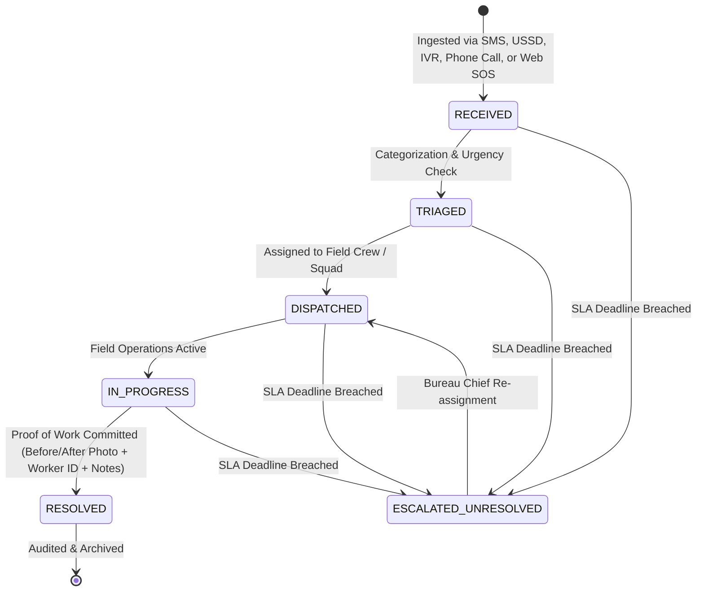

# Gondar SmartCivic (EthioCivic-Hub)
### Localized Omnichannel Municipal Incident Ingestion, Spatial Dispatching & Disaster Management System

[](https://ethiocivic-hub-project.onrender.com)
[](https://github.com/wagnew-nigussie/EthioCivic-Hub-project)
[](https://nodejs.org/)
[](https://postgis.net/)
[](https://opensource.org/licenses/MIT)

**Target Municipality:** Gondar City Administration, Amhara Regional State, Ethiopia  
**Urban Sub-Cities Covered (12 Zones):** Fasil (ፋሲል), Maraki (ማራኪ), Arada (አራዳ), Azezo-Teda (አዘዞ ቴዳ), Zobel (ዞብል), Jantekel (ጃንተከል), Bilajig (ብላጅግ), Gubaie (ጉባኤ), Adebabay-Piassa (አደባባይ ፒያሳ), Selam (ሰላም), Mintiwab (ምንትዋብ), Abraj (አብራጅ)  
**Spatial Coverage:** All-Ethiopia Extensible GIS Map (`EPSG:4326`) with Gondar Urban Core Focus (`12.6075° N, 37.4625° E`)  
**Bilingual Localization:** 100% Dynamic English (en) & Amharic (አማርኛ) Translation Engine  

---

## 🌐 Live Production Deployment & URLs

The system is deployed live on Render with automatic continuous integration and deployment (CI/CD):

- 🔗 **Live Web Application:** **[https://ethiocivic-hub-project.onrender.com](https://ethiocivic-hub-project.onrender.com)**
- 🐙 **GitHub Repository:** **[https://github.com/wagnew-nigussie/EthioCivic-Hub-project](https://github.com/wagnew-nigussie/EthioCivic-Hub-project)**

### Public Cloud Endpoints

| Service / Channel | Method & URL | Description |
| :--- | :--- | :--- |
| **Public Citizen Portal** | `GET https://ethiocivic-hub-project.onrender.com/` | Public reporting form, sub-city showcase, bilingual toggle. |
| **GIS Dispatch Command** | `GET https://ethiocivic-hub-project.onrender.com/#view-dispatch` | Spatial map, river catchments, and 5-tier queue triage. |
| **Sub-City Analytics** | `GET https://ethiocivic-hub-project.onrender.com/#view-analytics` | Executive KPI benchmark cards and resolution metrics. |
| **USSD Gateway (*840#)** | `POST https://ethiocivic-hub-project.onrender.com/api/v1/ussd` | 2G feature phone session state machine and fast flood SOS (*840*911#). |
| **Two-Way SMS (8065)** | `POST https://ethiocivic-hub-project.onrender.com/api/v1/sms/inbound` | Inbound keyword parser for regular and life-threatening emergencies. |
| **IVR Voice Hotline (8400)** | `POST https://ethiocivic-hub-project.onrender.com/api/v1/ingest/ivr` | Ingests spoken DTMF voice memo (.wav) and Amharic transcript. |
| **Direct Operator Phone Call**| `POST https://ethiocivic-hub-project.onrender.com/api/v1/ingest/phone-call` | Desk dispatcher intake for resident telephone calls. |
| **Incidents REST API** | `GET/POST https://ethiocivic-hub-project.onrender.com/api/v1/incidents` | Incident ingestion and 5-queue filtered querying. |
| **Resolution & Audit Proof** | `PATCH https://ethiocivic-hub-project.onrender.com/api/v1/incidents/:code/status` | Commits before/after photos, technician ID, and notes. |
| **Audio File Streaming** | `GET https://ethiocivic-hub-project.onrender.com/uploads/audio/sample_ivr.wav` | Direct binary audio stream for dispatcher playback. |

---

## 1. Project Overview & Problem Context

Gondar City experiences recurring municipal infrastructure challenges—such as broken water distribution mains (*GWSA*), power grid faults (*EEU*), uncollected solid waste, and road damage—across its 12 urban sub-cities.

A major barrier to civic engagement in Ethiopia is the **digital divide**: while some citizens use 4G smartphones, millions rely on basic 2G feature phones (*የእጅ ባትሪ ስልክ* / button phones) without mobile internet, and illiterate or elderly residents rely exclusively on voice telephone calls.

**Gondar SmartCivic** provides **universal public accessibility** by consolidating four unified ingestion channels into a centralized PostGIS spatial dispatch command dashboard:
- **Channel A: USSD (`*840#`)** - Multi-step interactive session for 2G button phones covering all 12 sub-cities and fast flood SOS (`*840*911#`).
- **Channel B: Two-Way SMS (`8065`)** - Bilingual text parser extracting `REPORT [CATEGORY] [SUBCITY] [LANDMARK]` and `EMERGENCY [HAZARD] [SUBCITY] [DETAILS]`.
- **Channel C: IVR Voice Hotline (`8400`) & Direct Phone Desk** - Amharic DTMF menu with 30-second caller voice note recordings for illiterate residents, playable directly in dispatcher ticket cards.
- **Channel D: Smartphone & Web App (PWA)** - Client-side image compression, All-Ethiopia Leaflet GPS capture, and offline-first IndexedDB queueing.
- **Visual & Heritage Identity:** Historic **Fasilides Castle (Fasil Ghebbi / የፋሲል ግቢ ካስል)** featured prominently on the landing page, with authentic contextual imagery across every portal view.

---

## 2. Omnichannel Ingestion Architecture

```
+---------------------------------------------------------------------------------------------------------+
|                                    GONDAR SMARTCIVIC INPUT CHANNELS                                     |
+-------------------+--------------------+---------------------------------------+------------------------+
| 2G Feature Phones | 2G Feature Phones  | Voice Callers (Elderly/Illiterate)    | Smartphone & Web Users |
| USSD (*840#)      | SMS (Shortcode 8065)| IVR Voice Hotline (8400)              | Offline-First PWA/App  |
+---------+---------+---------+----------+-------------------+-------------------+-----------+------------+
          |                   |                              |                               |
          v                   v                              v                               v
+---------+---------+---------+----------+-------------------+-------------------+-----------+------------+
| Ethio Telecom /   | SMS Gateway / SMPP | Asterisk PBX / Audio Storage          | Client-side GPS +      |
| USSD Gateway      | Webhook Endpoint   | (30s Voice Recording to S3/MinIO)     | WebP Compression       |
+---------+---------+---------+----------+-------------------+-------------------+-----------+------------+
          |                   |                              |                               |
          +-------------------+--------------+---------------+-------------------------------+
                                             |
                                             v
                      +---------------------------------------------+
                      |         UNIFIED REST API GATEWAY            |
                      |          (Pure Node.js Standard Lib)        |
                      +----------------------+----------------------+
                                             |
                                             v
                      +---------------------------------------------+
                      |          POSTGRESQL 16 + POSTGIS            |
                      | Spatial Geometries (Point, Polygon EPSG:4326)|
                      +----------------------+----------------------+
                                             |
                        +--------------------+--------------------+
                        |                                         |
                        v                                         v
+---------------------------------------+ +---------------------------------------+
|  CENTRAL DISPATCH COMMAND DASHBOARD   | |      5-TIER TRIAGE QUEUES STREAM      |
|  (/dispatch & /admin/analytics)       | |      (🚨 Emerg, 🛠️ Gen, 🎙️ Voice, ...) |
+---------------------------------------+ +---------------------------------------+
```

---

## 3. Incident Lifecycle & 5-Tier Dispatcher Queues

### 3.1 State Machine Lifecycle
Incidents follow a strict formal lifecycle:
`RECEIVED` &rarr; `TRIAGED` &rarr; `DISPATCHED` &rarr; `IN_PROGRESS` &rarr; `RESOLVED` (or `ESCALATED_UNRESOLVED` upon SLA breach).



### 3.2 5-Tier Municipal Dispatcher Queues

| Tab | Queue Name | Operational Scope | Live Card Elements |
| :--- | :--- | :--- | :--- |
| **Tab 1** | **🚨 Emerg** | Flash floods, trapped residents, live sparking wires | Red pulsing badge, trapped person counter, water depth level, one-tap rescue squad dispatch. |
| **Tab 2** | **🛠️ General** | Potholes, standard water leaks, uncollected waste | Nearest municipal crew ETA, dispatch action, resolve modal trigger. |
| **Tab 3** | **🎙️ Voice** | Inbound IVR calls (8400) & direct phone intakes | Embedded `<audio controls>` player (`.wav`), spoken Amharic transcript, caller phone number. |
| **Tab 4** | **⏳ SLA Overdue**| Unaddressed tickets exceeding municipal response limits | Red `⚠️ SLA EXPIRED` badge, hours pending clock, automated escalation flag. |
| **Tab 5** | **✅ Resolved** | Auditable resolution archive for city inspectors | Side-by-side **Before & After photos**, Field Worker ID (`TECH-GWSA-04`), fix duration (`time_to_fix_minutes`). |

---

## 4. Flood Hazard & Disaster Module (የጎርፍ አደጋና መኖሪያ ቤት መጥለቅለቅ)

During the Ethiopian rainy season (*Kiremt* / ክረምት), torrential rain causes rapid river swell along the **Angereb River Catchment** (*የአንገረብ ወንዝ*) and **Keha River Corridor** (*የቀሃ ወንዝ*), combined with blocked drainage canals. This causes catastrophic flash floods and residential inundation (**ጎርፍ ወደ ቤት መግባት**).

- **Tier-1 Critical Rescue Triage:** Automatically triggers visual and auditory alarms on the Dispatcher Dashboard.
- **Omnichannel SOS Reporting:**
  - **Smartphone/Web:** Single-tap "Flood Emergency SOS" sharing live GPS, water depth level, and trapped persons.
  - **USSD (*840#):** Dial `*840*911#` or Main Menu Option `0` (*የጎርፍ አደጋ አስቸኳይ ጥሪ*).
  - **SMS SOS:** Keywords like `EMERGENCY FLOOD [SUBCITY] [LANDMARK]`.
  - **IVR Hotline (8400):** High-priority emergency voice note recording.
- **GIS River Risk Layers & Geofenced Early Warning:** Visualizes river catchments and enables municipal admins to broadcast mass warning SMS messages to residents in vulnerable zones.

---

## 5. Local Setup & Testing

### Running Locally
```bash
# Clone the repository
git clone https://github.com/wagnew-nigussie/EthioCivic-Hub-project.git
cd EthioCivic-Hub-project

# Start the server (zero npm dependencies required!)
node server/server.js
```
Open **`http://localhost:5000`** in your browser.

### Automated Test Suites
Run the verified test suites:

```bash
# Omnichannel ingestion, 5 queues, and lifecycle state machine (100% passing)
node test_omnichannel_lifecycle.js

# Local imagery, 12 sub-cities, and bilingual UI verification (100% passing)
node test_images_and_positions.js
```

### Docker Deployment
```bash
docker compose up -d --build
```
Runs the application on `http://localhost:5000` and PostGIS spatial database on port `5436`.

---

## 6. Photographic Heritage & Sub-City Directory

| Asset File | Target Portal Position | Description & Local Context |
| :--- | :--- | :--- |
| `/images/gondar_fasiledes_castle.jpg` | **Landing Page Hero Section (`/`)** & **Navbar Logo Badge** | Iconic ground-level facade of Emperor Fasilides Castle (*የአፄ ፋሲል ቤተመንግስት*) with domed watchtowers and battlements. |
| `/images/gondar_fasil_ghebbi_aerial.jpg` | **Report Banner (`/report`)** & **Analytics Banner (`/admin/analytics`)** | High-resolution panoramic drone aerial overview of the UNESCO Fasil Ghebbi royal enclosure. |
| `/images/subcities/sc_01_fasil.jpg` to `sc_12_abraj.jpg` | **12 Sub-Cities Showcase Carousel** | Dedicated authentic photographic views for each of Gondar's 12 urban sub-cities. |
| `/images/categories/*.svg` | **Category Cards & Ticket Feeds** | 5 high-contrast vector illustrations for Water Leak, Electrical Fault, Solid Waste, Road Damage, and Flash Flood Emergency SOS. |

---

## 7. License & Credits

- **Author:** Wagnew Nigussie (Final-Year B.Sc. Software Engineering Capstone Project)
- **Target Municipality:** Gondar City Administration, Amhara Region, Ethiopia
- **License:** [MIT License](https://opensource.org/licenses/MIT)
